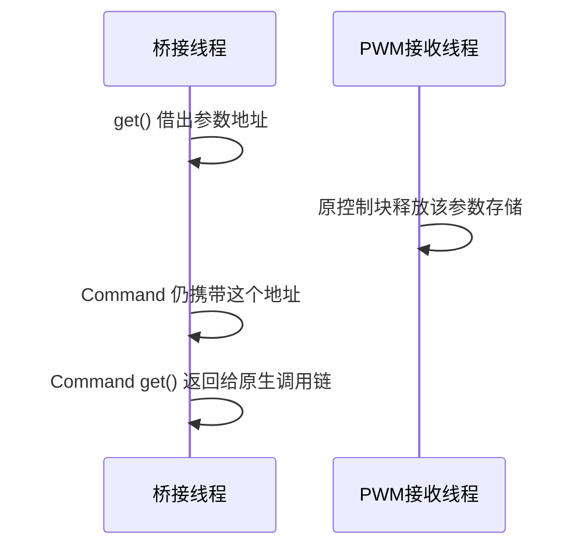

# 本地 PWM 角速度冲击与 ROS 桥接并发调查

2026-10-20，官方 README 仍提供 12.0.0.5。遵循已核对比赛规则，原模拟器、ROS 插件、碰撞/超时设置保持不变，RpcEnabled=false；控制节点只读取 initial_pose、IMU、GPS，指令不超过 100Hz，PWM 与 VEL 不混发。此文是本地调查记录，尚未提交上游，也不是官方缺陷确认。

## 冻结实验

运行 `OPENBLAS_NUM_THREADS=1 python3 -m evaluation.seed_runner.bridge_comparison`。协议见 `configs/bridge_comparison_v1.json`：开发种子 2024/2041，每种子每模式重复 3 次，14s 悬停，开启同一静止初始化，参数不调节；三种模式的顺序按组轮换。每场均新建模拟器，控制结束后关闭自有场次。

| 模式 | 场次 | 角速度保护触发 | 控制完成 | 独立指令审计失败 | 控制与全部评测通过 |
|---|---:|---:|---:|---:|---:|
| 原始，未插桩 | 6 | 2 | 4 | 1 | 3 |
| observe | 6 | 3 | 3 | 1 | 2 |
| serialize | 6 | 0 | 6 | 0 | 6 |

控制完成和审计通过分别统计。两场漏录分别发生于完成控制的原始/observe 场次，共缺失三条指令记录（原始 seq598，observe seq139/224），不能称为物理故障，也不能从严格结果中剔除。所有五次角速度故障的线上载荷审计通过，独立姿态记录也确认旋转；不只是估计状态异常。

18 场使用同一份 205 文件源码内容与相同探针构建，逐场复核原模拟器、插件、配置和容器摘要。批次及每场的 19 个源码归档全部独立读取、逐文件重算 SHA256，与冻结清单一致。小型证据、每场目录及摘要见 `docs/evidence/p0_bridge_frozen_comparison.json`；完整清单和原始数据保留在本地 runs/batches/20261020T103124Z_5fdab8d727de4f54b368b7df33791976 及对应运行目录。源码包含当时尚未提交的实验工具；不能仅用父提交 9a6ce9e 代替归档内容。

## 当前证据支持什么

只读检查限于公开 ROS 桥接接口，不读取游戏对象、赛道布局或额外算法输入。固定插件 SHA256 为 `69d5ea3302bdd5f20b842ec3d3e84bafcb50ef3649ada42c4d346c9bcd389885`。

- `ROTOR_PWM_Callback`（0x1862f0）接收四个 double，转换为 float 参数并替换共享参数对象。
- `PublishAsyncCommands`（0x18dcc5）在 0x18dd9d 调用参数 shared_ptr 的 get()，随后用裸指针构造 Command，再在 0x18dddf 调用原生回调；该段未见持有参数所有权的局部副本或互斥。
- 时序探针确认两函数在不同线程重叠执行。三个 observe 失败场次中，故障附近最近的重叠入口分别早于对应姿态消息到达约 20.31/20.22/15.31ms。该间隔使用 CLOCK_MONOTONIC 与记录进程到达时间，是消息到达相关性，不是电机施加延迟或指针使用时刻。
- serialize 仅在两个原函数外加互斥，六场未出现角速度保护。它改变线程调度；少量零故障样本不能证明根因或普适修复，原始运行故障仍未关闭。

实际退出未产生探针最终 exit 记录，调用计数仅为下界；不能凭最后一个周期计数推断整场精确调用频率。宿主 68 项单元测试通过；Noetic 65 项通过、3 项需 Git 的宿主归档测试跳过。

静态所有权疑点、实际重叠和冻结对照共同加强了桥接并发方向的调查依据。以下存活期追踪进一步捕获提前释放后交接，但尚未观察消费端的载荷读取，不能宣称已经证明实际 use-after-free 读取或历史冲击因果，也不能用低频 debug PWM 排除实际输入瞬变。

## 参数存活期追踪（迭代 25）

`--bridge-probe lifetime` 使用独立编译变体，额外包装该 PWM 参数类型的 shared_ptr::get、控制块 _M_destroy、Command 两种构造入口及 Command shared_ptr::get。参数引用、返回地址与原函数调用全部透传；只记录地址、线程、单次桥接 span 和单调时间，不解引用载荷、不读取游戏对象。释放前的参数地址通过原类型的 _M_ptr 获取，释放仍完全由原 _M_destroy 执行。默认并发探针不编译这些额外包装。

自有 mock 用两线程显式控制先后顺序，分别覆盖交接前释放、交接后释放及两种构造符号；不读已释放存储，检查原函数均仅执行一次、参数透传、审计分类正确。宿主 72 项单元测试通过；Noetic 69 项通过，3 项宿主 Git 测试跳过；两项原生集成测试通过。

随后冻结协议 configs/bridge_lifetime_comparison_v1.json：2024/2041 各两次原始/lifetime 轮换对照，共 8 场。211 个源文件内容、原模拟器和配置摘要一致，9 个归档独立逐文件重核。全部控制完成，无角速度故障；一场 lifetime 缺少 seq479 的线上记录，严格审计失败。四场 lifetime 中两场各捕获一次“借用完成→另一线程释放完成→同一参数地址经 Command 交接”的严格时序。此前探索场次另捕获一次，但不混入本次冻结统计。

只读复核 0x194a68 的 Command 构造函数确认：仅保存类型地址及参数裸指针，没有复制四个 PWM 数值或持有参数所有者。因此本机插桩桥接中的提前释放与后续交接已复现。审计刻意排除 get() 调用前已结束的旧地址释放、与 get() 时间窗重叠的不确定事件以及不完整桥接 span。它不观察原生消费者实际读取、分配器复用或电机施加内容；这些存活期事件也出现在没有角速度故障的场次中，不能直接宣布历史物理冲击原因已确认。

机器可读证据及具体地址/纳秒时序见 docs/evidence/p0_bridge_lifetime.json，原始记录在对应 runs 目录；全部实际调用计数仍按无最终 exit 记录的下界解释。插桩改变调度，本次不构成 P1 验收。

## 下一项验证及修复边界

存活期故障证据已经形成。下一步评估主控制器对已观测瞬态角速度冲击的有界恢复能力，先模型验证、再分级实测；不直接放宽现有保护阈值，也不依赖插桩环境完成验收。保留未插桩对照及后续核验接口修复的证据。

若上游确认此处存在并发所有权问题，修复候选是：接收端在互斥下发布不可变参数所有者；发送端在相同保护下复制持有所有权的快照，再交给消费端。若消费是异步的，Command 必须持有该所有者直至消费完成。该建议尚未在官方实现验证，不作为当前项目完成项。

诊断库不进入部署镜像，不以更改官方模拟器完成 P1 验收。competition runtime_control_enabled 仍为 false。持续 IMU 失联处理、完整制动包络、正式权限与后续 P2–P7 均需继续实现和验证。

官方来源：[模拟器 README](https://github.com/RoboMaster/IntelligentUAVChampionshipSimulator/blob/RMUA2026-01/README.md)、[规则中心](https://bbs.robomaster.com/wiki/20204847/809873?source=7)。规则 PDF 摘要与逐项核对见 configs/official_rules_baseline.json 和 docs/official_rules_review.md。
